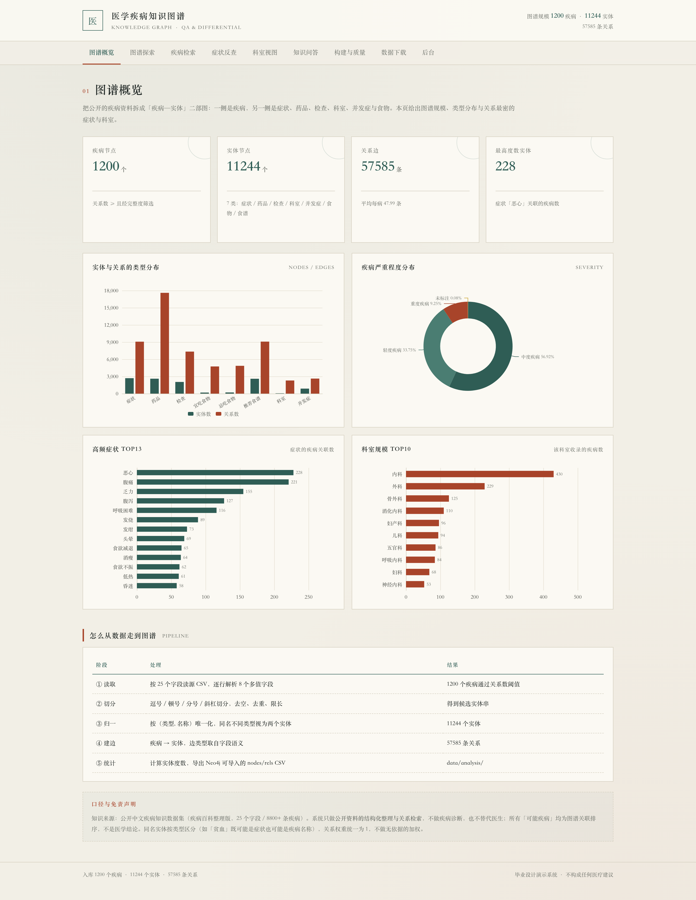
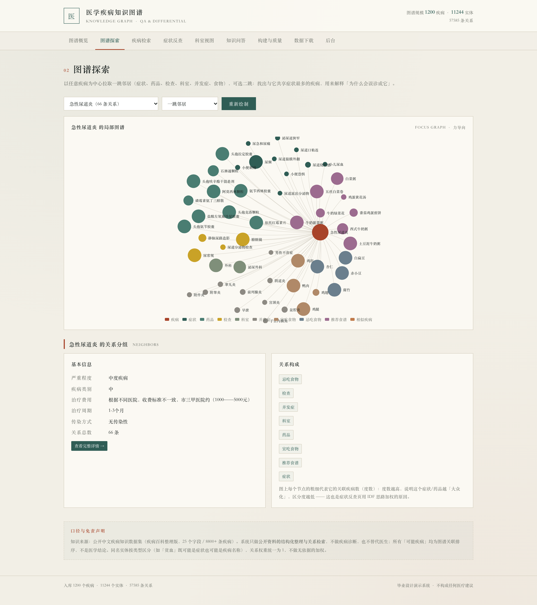
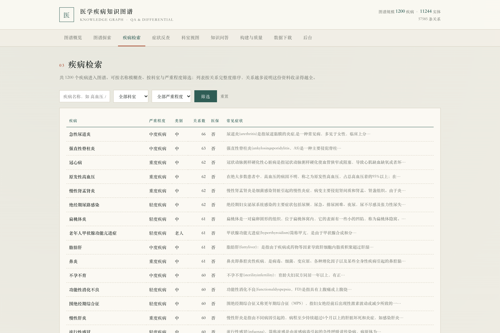
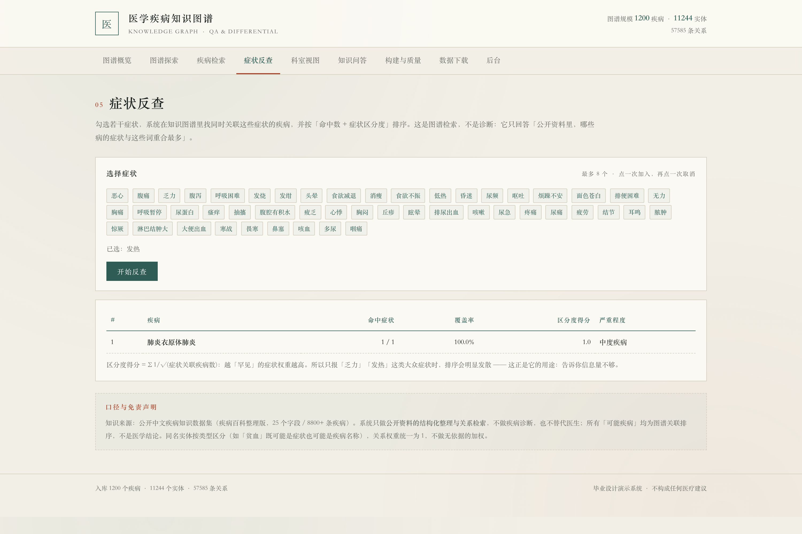
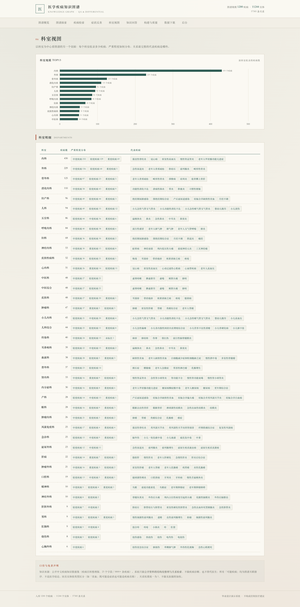
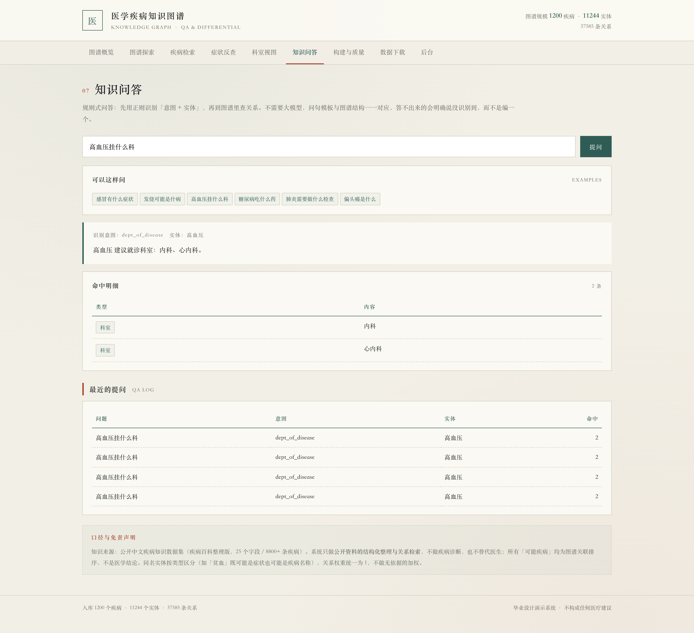
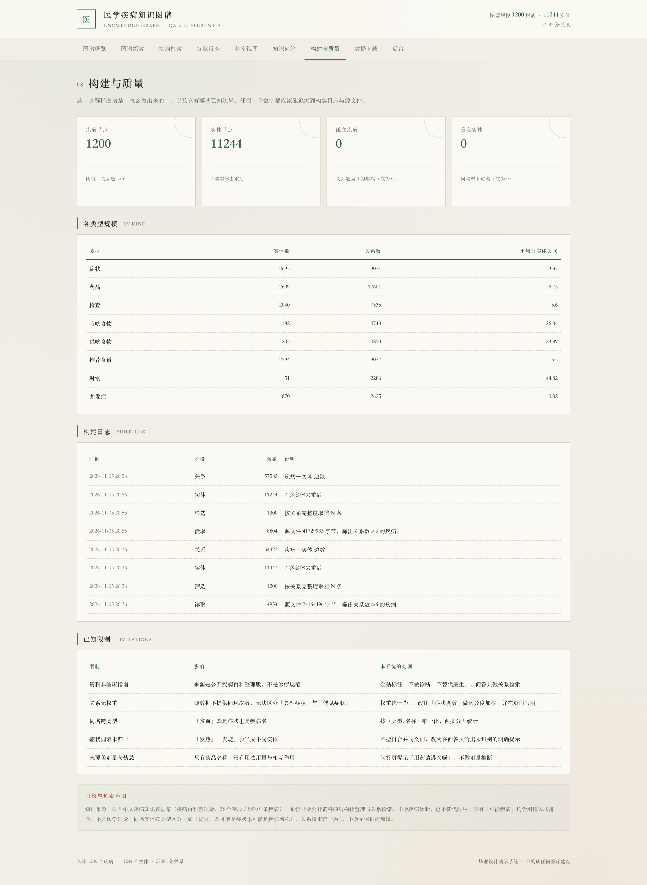
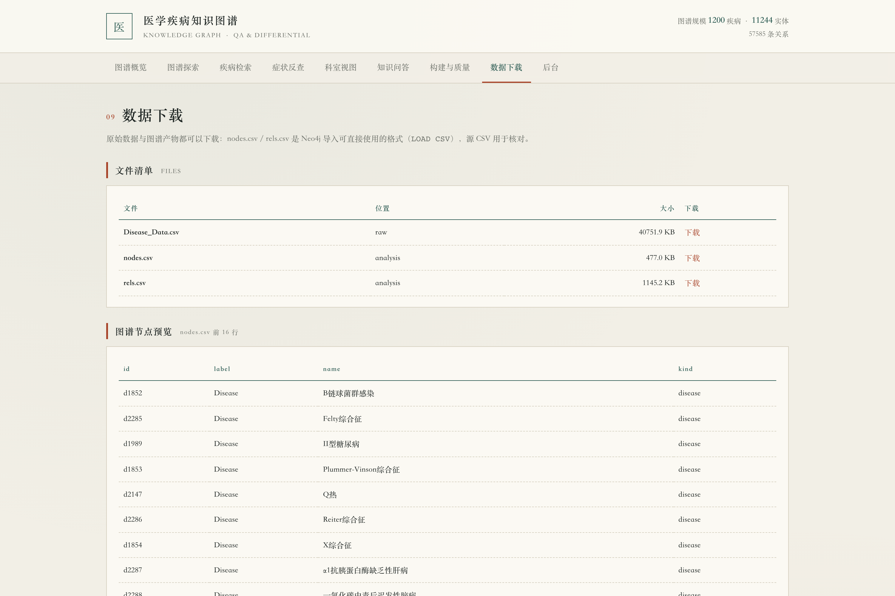

# 021 基于知识图谱的医学疾病问答与辅助诊断系统-设计展示

> **代码有偿获取 可接受定制 微信联系方式: csbysj2020 或 ACE2487，备注(BS)**

> **完整源码与全套文档 · 在线自助获取 >>> [https://mbd.pub/o/bread/YZaWlZdtaQ==](https://mbd.pub/o/bread/YZaWlZdtaQ==)**

> **成品页（功能介绍 / 更多选题）>>> [https://bishe.suilang.net/products/medical-kg-qa](https://bishe.suilang.net/products/medical-kg-qa)**

> 

> 

## 视频

> **点击查看 >>> [https://www.bilibili.com/video/BV16m4h6REKA/](https://www.bilibili.com/video/BV16m4h6REKA/)**

## 项目简介

本项目把公开的中文疾病资料整理成「疾病—实体」二部图：一侧是疾病节点，另一侧是症状、药品、检查、科室、并发症与食物。源数据为 25 个字段、8805 条疾病的公开数据集，经关系完整度筛选后取 1200 个疾病入图。

系统实现力导向图谱探索（一跳邻居与二跳相似疾病）、疾病检索与详情、症状反查（IDF 加权）、科室视图、规则式知识问答（6 类意图）、构建与质量、数据下载共 9 个页面，并导出 Neo4j 可直接 LOAD CSV 的 nodes.csv 与 rels.csv。

本仓库为**设计展示**：包含项目说明、技术架构、实验结果与运行截图；完整源码、任务书、开题报告、毕业论文与使用说明可通过上方链接自助获取，成品页可查看更多选题，也可联系微信咨询定制。

## 功能特性

1. 真实数据：公开中文疾病数据集 25 字段 / 8805 条，随包提供；抽出 1200 疾病 / 11244 实体 / 57585 关系（平均每病 48 条），孤立疾病与同类型重名均为 0

2. 实体归一口径：以（类型, 名称）为唯一键，「贫血」既是症状也是病名时分存两个节点，避免症状反查把病名当症状统计

3. 关系不加权：源数据不提供同现次数，按位置拍脑袋加权无法解释；权重统一为 1，改用症状度数做区分度加权（IDF 思路）

4. 同义词如实不合并：实测「发热」只关联 1 个疾病、「发烧」关联 89 个，静默合并会改变口径，页面改为提示「改搜发烧」，论文 6.3 节专门讨论

5. 图谱探索可交互：以疾病为中心拉取一跳邻居（症状/药品/检查/科室/并发症/食物），二跳按共享症状找出最易混淆的相似疾病

6. 规则问答 6 类意图：病→症状、症状→病、病→药、病→科室、病→检查、是什么；6 条典型问句全部命中正确意图与实体，答不出时明确说没识别到

7. 9 个功能页面：概览 / 图谱探索 / 疾病检索 / 详情 / 症状反查 / 科室视图 / 知识问答 / 构建与质量 / 数据下载，ECharts 本地内置离线可用

8. 可迁移：nodes.csv 与 rels.csv 可直接 LOAD CSV 导入 Neo4j；构建命令幂等，改阈值即可扩到全量 8805 条

## 技术架构

| 项目 | 说明 |
| --- | --- |
| 编程语言 | Python 3.8 及以上 |
| 后端框架 | Django 4.2 |
| 图谱构建 | 自定义 build_graph 管理命令（切分 / 归一 / 建边 / 度数 / Neo4j 导出） |
| 数据处理 | Python 标准库 csv + collections |
| 数据库 | MySQL 8.0（交付默认 SQLite，免安装） |
| 可视化 | ECharts 5（力导向图 / 柱状图 / 饼图，本地内置） |
| 数据规模 | 1200 疾病 / 11244 实体 / 57585 关系（源数据 8805 条） |
| 操作系统 | Windows / macOS / Linux |
| 启动方式 | 双击一键脚本，或 python manage.py runserver 8087 |

## 目录结构

以下为完整交付版的结构（本仓库仅作设计展示）：

```
medical-kg-qa/
├── 任务书/
│   └── 毕业设计任务书.docx
├── 开题报告/
│   └── 毕业设计开题报告.docx
├── 最终论文/
│   ├── 图/
│   │   ├── 图3-1_系统用例图.png
│   │   ├── 图4-1_系统架构图.png
│   │   ├── 图4-2_功能模块图.png
│   │   ├── 图4-3_图谱构建流程图.png
│   │   └── 图4-4_数据库ER图.png
│   └── 基于知识图谱的医学疾病问答与辅助诊断系统设计.docx
├── 源码/
│   ├── crawler/
│   ├── data/
│   │   ├── analysis/
│   │   └── raw/
│   ├── kg/
│   │   ├── management/
│   │   ├── migrations/
│   │   ├── __init__.py
│   │   ├── admin.py
│   │   ├── apps.py
│   │   ├── models.py
│   │   ├── urls.py
│   │   └── views.py
│   ├── medkg/
│   │   ├── __init__.py
│   │   ├── settings.py
│   │   ├── urls.py
│   │   └── wsgi.py
│   ├── static/
│   │   ├── css/
│   │   ├── vendor/
│   │   └── favicon.svg
│   ├── templates/
│   │   ├── base.html
│   │   ├── departments.html
│   │   ├── disease.html
│   │   ├── diseases.html
│   │   ├── explore.html
│   │   ├── home.html
│   │   └── …
│   └── …
└── …
```

## 图谱规模与三处取舍

| 指标 | 结果 |
| --- | --- |
| 图谱规模 | 1200 疾病 / 11244 实体 / 57585 关系（平均每病 48 条） |
| 质量校验 | 孤立疾病 0、同类型重名实体 0 |
| 问答 | 6 类意图模板，6 条典型问句全部命中正确意图与实体 |

1. **同名跨类型**：「贫血」既是症状也是疾病名，按（类型, 名称）分存两个节点，不合并统计。
2. **关系不加权**：源数据不给同现次数，按位置拍脑袋加权无法解释，权重统一为 1，改用症状度数做区分度加权。
3. **同义词只提示不合并**：实测「发热」只关联 1 个疾病，「发烧」关联 89 个，静默合并会直接改变统计口径，因此页面只提示「改搜发烧」。这是论文 6.3 节的核心发现。

## 交付内容

1. 完整源码（Django 工程 + 图谱构建命令 + 演示数据库）
2. 原始数据集与图谱导出文件（nodes.csv / rels.csv / findings.json）
3. 毕业设计任务书（Word）
4. 毕业设计开题报告（Word）
5. 毕业论文（Word，七章制，含同名归一、不加权、同义词不合并三处取舍与评估）
6. 系统使用与二次开发说明（Word + md）
7. 系统运行截图 10 张 + 功能演示视频

## 常见问题

**数据是真的吗？**

是。源文件 25 个字段、8805 条疾病，随包放在 源码/data/raw/Disease_Data.csv。图谱节点与关系全部从这份文件抽取，没有一条是合成的。

**为什么只有 1200 个疾病？**

8805 条里先按「关系数 ≥ 6」筛，再按关系完整度取前 1200 条入图。全量入图会让力导向图无法阅读、页面明显卡顿。想要更多就调 medkg/settings.py 的 KG["MAX_DISEASES"] 再重跑 build_graph，建议不超过 2000。

**关系为什么不分轻重？**

源数据只说「这个病有这些症状」，不给同现次数或典型程度。按位置拍脑袋加权（排前面的更重要）结论无法解释，也无法向读者交代。所以权重统一为 1，改用症状自身的度数做区分度加权 —— 越少见的症状权重越高。

**「贫血」怎么既是症状又是病？**

数据里确实两种都有。系统以（类型, 名称）为唯一键，存成两个节点，统计时分开算。若只按名字合并，症状反查会把疾病名当作症状统计，结果会失真。

**为什么搜「发热」几乎没结果？**

因为数据里「发热」只关联 1 个疾病，而「发烧」关联 89 个，同义词没有合并。系统不会静默合并（那会改变统计口径），而是在页面提示「改搜发烧」。这个现象写进了论文 6.3 节，是本文最重要的发现之一。

**这个系统能诊断吗？**

不能，也不应该这样用。它只做公开资料的结构化整理与关系检索：症状反查返回的是「哪些病的症状与所选词重合最多」，不是医学结论。页面底部有固定免责声明，论文里也写明了。

## 截图











